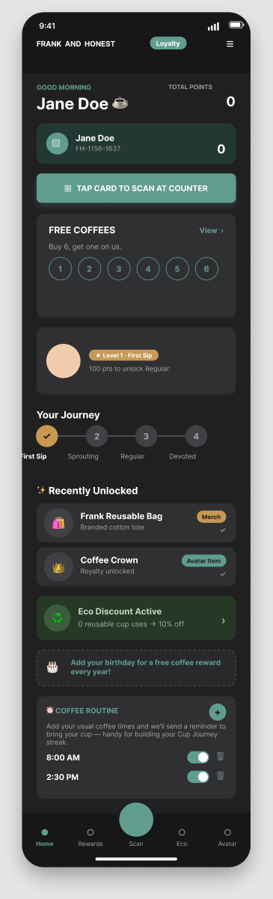

# Cedric Mathias — Portfolio

Personal portfolio for Cedric Mathias — Growth Marketer who designs, Designer who ships. Static site, deployed with GitHub Pages.

**Live site:** https://cedricmathias1.github.io

## What's in here

Single-page home (`index.html`) plus three standalone case-study pages. All static HTML/CSS/JS — no build step, no framework, no dependencies.

| File | Page |
|---|---|
| `index.html` | Home — intro, results, skills, contact |
| `musgrave.html` | Case study: Frank & Honest / Musgrave reusable-cup loyalty ecosystem |
| `drip.html` | Case study: Drip Circular App |
| `usch.html` | Case study: Unified Student Communication Hub |
| `images/` | Screenshots used across the case studies |
| `Cedric-Mathias-CV.pdf` | Downloadable CV |

## Stack

HTML5, CSS3 (custom properties, no framework), vanilla JavaScript. Fonts via Google Fonts. Every page ships its own SEO metadata — Open Graph, Twitter Card, and Person JSON-LD.

## Preview



## Case studies

- **Frank & Honest Reusable Cup Initiative** — UCC MSc capstone with Musgrave Group; Figma prototyping and behavioural design across three connected loyalty PWAs. [Live prototypes →](https://frank-and-honest-app.vercel.app)
- - **Drip Circular App** — 12-week design-thinking sprint for a fast-fashion retailer's circular-economy service.
  - - **Unified Student Communication Hub** — 0→1 UX research project validated with UCC students in moderated usability testing.
   
    - ## Running locally
   
    - No build step — clone the repo and open `index.html`, or serve the folder with any static server:
   
    - ```
      npx serve .
      ```

      ---

      📍 Dublin, Ireland · [Portfolio](https://cedricmathias1.github.io) · [LinkedIn](https://linkedin.com/in/cedric-mathias)
      
